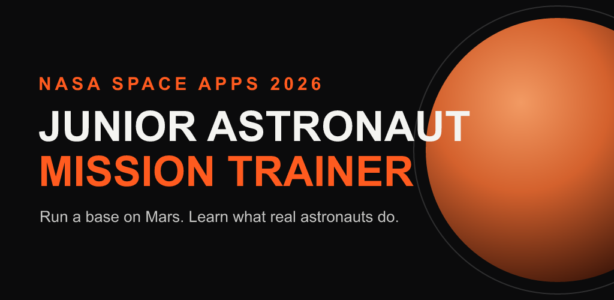

# Lunar Lifeline: Junior Astronaut Mission Trainer

> **14 sols on Mars. 12 hard choices. Real NASA data. Can you bring your crew home?**

**▶ Play now:** https://nasa-hack-26.pages.dev. Nothing to install and no sign-in. It runs on laptops, tablets and phones.

Made by **Vantaloc Space** (team **Binary Bandits**) for **NASA Space Apps Challenge 2026**, challenge: *Build a Junior Astronaut Mission Trainer*. Built for kids aged 7 to 12, **in English and Bangla**.



---

## The idea in 30 seconds

- **The problem:** Space science feels distant to kids. They read about radiation and dust storms, but they don't *feel* why astronauts care.
- **Our answer:** Kids become the commander of a real-feeling Mars mission. Every danger they face is drawn from **real NASA data**, and every choice has a **real cost**.
- **The result:** Kids don't memorise facts. They *use* them to keep their crew alive.

## What makes it stand out

| | |
|---|---|
| 🛰️ **Built on live NASA data** | The solar storms come from **NASA's DONKI** space weather database: real dates, real speeds (2,650 km/s), real strengths (Kp 9, 10 May 2024). |
| ⚖️ **Choices that really matter** | A hidden model tracks **fuel, time and crew health**. We tested all **4,096 possible paths**: only about 41% get home, and **every one of the 12 decisions can change the ending**. There's no "always pick A". |
| 🧪 **Every fact is sourced** | Each fact card links to the NASA page it comes from: InSight, Curiosity, MAVEN, Perseverance/MOXIE, Opportunity, Phoenix, CHAPEA and NTRS papers. Automated tests check the links are there. |
| 📖 **A story kids want to finish** | A crew with personalities (Mei the doctor, Tunde the engineer, Pip the robot) who chat, joke and get interrupted by disasters. |
| 🎓 **Learning after the ending** | A mission debrief shows the **one choice that flipped your ending**, what each decision cost, your radiation dose against NASA's career limit, and science cards on bones, eyes, isolation and radiation. |
| 🌏 **Two languages** | Full Bangla version written in natural, everyday Bangla with Bangla numerals, for millions of kids who rarely get science games in their own language. |
| ♿ **Accessible by design** | Read-aloud, a Reduce motion switch, keyboard play (A/B, arrow keys), large text and sound on/off. |
| 🔒 **Zero tracking** | No accounts, ads or analytics. The game works offline once loaded. |

## How the mission plays

| Part | Sols | What happens | Science kids learn |
|---|---|---|---|
| **1. Arrival** | 1–3 | Documentary-style opening, pick a landing site, **land the craft yourself** (hold Space to fire the thrusters), build the base | Distance to Mars, gravity, landing, what a base needs |
| **2. Survival** | 4–8 | Planet-wide **dust storm**, **CO₂ build-up**, a **solar storm** warned by Earth | Solar power, air recycling, perchlorate, radiation and shielding with water |
| **3. The way home** | 11–13 | A **marsquake** cracks the fuel seal, then **launch day** | Marsquakes (InSight), making fuel from Mars air (MOXIE), launch windows |
| **Ending + debrief** | 14 | **Home** or **Stranded**, then the mission report | How small choices add up, and real astronaut health risks |

## NASA data and resources

| Resource | How we used it |
|---|---|
| **DONKI** via `api.nasa.gov` and CCMC | 54 solar particle events and 47 geomagnetic storms (2017, 2023–2025) power the storm story, warnings and crew chats |
| **NASA mission science** (InSight, Curiosity RAD, MAVEN, Perseverance, Opportunity, Spirit, Phoenix, Viking) | Fact cards, crew dialogue and debrief numbers (e.g. 0.67 mSv per sol on the surface) |
| **NASA Human Research** (CHAPEA, bone and vision studies, ISS research) | Debrief science cards |
| **NASA Technical Reports Server** | CO₂ and life-support facts |

Full list and fact check: [docs/NASA-DATA.md](docs/NASA-DATA.md). No partner space agency data was used.

## Tech stack

- **Language:** TypeScript
- **Framework:** React 19 and Vite
- **Graphics:** hand-coded inline **SVG**. We drew all art ourselves, with no image assets.
- **Audio:** synthesised live with the **Web Audio API**. There are no sound files.
- **Testing:** Vitest. 100+ tests cover game balance across all 4,096 paths, fact sources and Bangla text.
- **Hosting:** Cloudflare Pages. It's a fully static site: no server and no database.
- **Hardware needed:** any modern browser. There are no special devices.
- **Open source we used:** React, Vite, TypeScript, Vitest, @resvg/resvg-js, and Fontsource fonts (Saira, IBM Plex Mono, Noto Sans Bengali, SIL Open Font License).

## Run it locally

Needs Node.js 20+.

```bash
npm install
```

```bash
npm run dev
```

Open http://localhost:5173.

| Command | What it does |
|---|---|
| `npm test` | Run all tests (balance, sources, translations) |
| `npm run typecheck` | TypeScript check |
| `npm run build` | Production build into `dist/` |

## Learn more

- [docs/design/04-story-plan.md](docs/design/04-story-plan.md): the full story, scoring model and sources
- [docs/ARCHITECTURE.md](docs/ARCHITECTURE.md): how the code is organised
- [CONTRIBUTING.md](CONTRIBUTING.md): how the team works

## Team

**Vantaloc Space** (team Binary Bandits), NASA Space Apps Challenge 2026.
Team Member: 
Hasin Ishrak Labib
Kazi Walid Hasan
Tijul Kabir Toha

