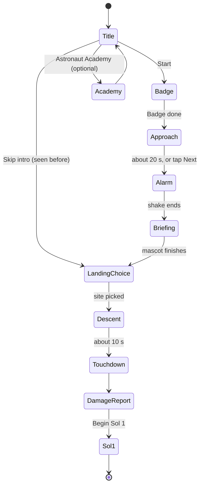
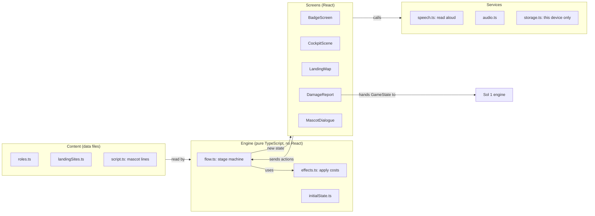

# Opening sequence: role selection to hard landing

Status: draft 1, for team review. All numbers are first-pass values to be checked by the balance bots.

## 1. Scope and goals

This covers everything from the title screen until the first sol (Mars day) on the base starts.

| Goal | How we check it |
|---|---|
| First real decision within 2 minutes on a first run | Stopwatch during playtest |
| Reach the base within 20 seconds on a replay | Skip button test |
| The landing choice teaches a real trade-off: safety vs water | Both options cost something; the bots show neither always wins |
| Nobody gets hurt, nothing is scary | Script review: no injury, calm mascot |
| Works for a 7-year-old who reads slowly | Every line is read aloud; no timers |

Out of scope here: the sols on the base, the power board and event cards (see the decision map).

## 2. Player flow



Skip goes to `LandingChoice`, not straight to the base, because the landing choice changes the game. A replay skips the story but keeps the decision.

| Stage | View | What happens | Player input | Time |
|---|---|---|---|---|
| Title | Mars still | Start, Astronaut Academy, Settings, Skip intro (second run on) | Tap | – |
| Badge | Badge card | Pick or type a name, pick a role, see the badge | Tap, optional typing | 20 s |
| Approach | Cockpit, first person | Mars grows in the window; ship computer (the mascot) greets the crew by name and role | Tap Next | 20 s |
| Alarm | Cockpit | Red light, screen shake, dust storm on the landing site radar | None | 5 s |
| Briefing | Cockpit | Mascot explains the storm and the radio delay: Earth can't help in time | Tap Next | 20 s |
| LandingChoice | Map of two or three sites | Each site shows what it costs and what it gives | Tap a site, then Confirm | Untimed |
| Descent | Window shot | Heat shield glow, parachute, rockets; mascot names each step | None | 10 s |
| Touchdown | Bump, fade | "Touchdown. Everyone is safe." | None | 3 s |
| DamageReport | Angled 2D base | Camera pulls out; damage depends on the site; mascot points at each gauge | Tap each gauge, then Begin Sol 1 | 30 s |

## 3. Architecture



Rules:

- **The engine never imports React.** It's plain functions: `next(state, action) → state`. The balance bots and tests call it directly, with no browser.
- **All words and numbers live in the content files.** The team can change dialogue, costs and roles without touching screen code.
- **Screens hold no game rules.** A screen only shows state and sends actions such as `PICK_ROLE` or `CONFIRM_SITE`.

## 4. Data model

```ts
type RoleId = "engineer" | "doctor" | "scientist";
type SiteId = "plains" | "iceValley" | "holdOrbit";
type Level = "cadet" | "commander";
type Stage =
  | "title" | "academy" | "badge" | "approach" | "alarm"
  | "briefing" | "landingChoice" | "descent" | "touchdown"
  | "damageReport" | "sol1";

interface Gauges { power: number; supplies: number; dose: number; science: number }

interface Role {
  id: RoleId;
  name: string;            // "Engineer"
  oneLiner: string;        // "Fixes machines faster"
  perk: Perk;              // applied by the engine, never by a screen
  fact: string;            // real-world line for the badge, checked against NASA/ESA
}

type Perk =
  | { kind: "repairDiscount"; power: number }   // engineer
  | { kind: "shelterDiscount"; supplies: number } // doctor
  | { kind: "scienceBonus"; science: number };  // scientist

interface LandingSite {
  id: SiteId;
  name: string;
  pitch: string;           // what the kid reads on the map
  levels: Level[];         // holdOrbit is Commander only
  effects: Partial<Gauges>;
  flags: Flag[];           // carried into Sol 1 and later
  lesson: string;          // shown in the damage report
}

type Flag = "PANELS_DAMAGED" | "NEAR_ICE" | "FAR_FROM_ICE";

interface DialogueLine {
  id: string;
  speaker: "mascot" | "earth" | "narrator";
  text: string;            // short, read aloud
  mood?: "calm" | "alert" | "happy";
}

interface GameState {
  stage: Stage;
  level: Level;
  player: { name: string; role: RoleId | null };
  site: SiteId | null;
  gauges: Gauges;
  flags: Flag[];
  settings: { readAloud: boolean; reduceMotion: boolean; sound: boolean };
  seenIntro: boolean;
}

type Action =
  | { type: "START" } | { type: "SKIP_INTRO" } | { type: "OPEN_ACADEMY" }
  | { type: "SET_NAME"; name: string } | { type: "PICK_ROLE"; role: RoleId }
  | { type: "NEXT" } | { type: "PICK_SITE"; site: SiteId } | { type: "CONFIRM_SITE" }
  | { type: "BEGIN_SOL_1" };
```

## 5. Content: roles and landing sites

### Roles

| Role | Perk | Where it shows up | Risk to watch |
|---|---|---|---|
| Engineer | Repairs cost 1 less power | Fixing damaged panels on Sol 1, the air filter later | Strongest with the ice valley; check with bots |
| Doctor | Shelter costs 1 less supplies | Solar storm sol | Weak if the run's storm is a dust storm |
| Scientist | +1 science on research choices | Event cards with science | Could make greedy play too easy |

Perks stay small (one point) so the role adds flavour without deciding the game. If the bots show one role winning much more often, cut its perk first.

### Landing sites

Start values come from the decision map: power 6, supplies 9.

| Site | Levels | Pitch to the kid | Effect | Flags | Lesson |
|---|---|---|---|---|---|
| Flat plains | Both | "Smooth ground, safe landing. But the ice is far away." | Supplies −1 | `FAR_FROM_ICE` | Safe choices can cost you later |
| Ice valley | Both | "Water ice nearby! But it's rocky, so landing will be bumpy." | Power −3 | `NEAR_ICE`, `PANELS_DAMAGED` | Water is precious, and risk has a price |
| Wait in orbit | Commander | "Circle Mars until the storm clears, then land at the ice." | Supplies −2, Dose +2 | `NEAR_ICE` | Waiting costs supplies, and space has more radiation than the surface |

Later effects:

- `NEAR_ICE` unlocks a "Melt ice for water" option on water cards.
- `FAR_FROM_ICE` makes water cards cost 1 more.
- `PANELS_DAMAGED` makes Sol 1 a repair task; the base makes 2 fewer power blocks per sol until it's fixed.

Real-world grounding to check before shipping: water ice near the surface on Mars (found by the Phoenix lander in 2008 and mapped from orbit), and higher radiation in space than on the Martian surface (Curiosity's RAD measured both).

## 6. Mascot script (draft)

Working name: **Pip** (placeholder). Pip is the ship's computer in Acts 1–2 and moves into the rover after landing, so the same character runs through the game.

| Stage | Line |
|---|---|
| Approach | "Hello, {name}! I'm Pip, your ship's computer. Our ship has been flying for seven months. That's Mars ahead!" |
| Approach | "As our {role}, you're in charge of keeping the crew safe on the base." |
| Alarm | "Uh oh. A dust storm is blowing over our landing spot." |
| Briefing | "Earth is so far away that a radio message takes 12 minutes to get there. Landing takes about 7 minutes. So we have to decide ourselves." |
| Briefing | "Let's look at the map together. Every choice has a cost. There's no perfect answer." |
| LandingChoice | Reads the site's pitch when tapped |
| Descent | "Heat shield... parachute... rockets... here we go!" |
| Touchdown | "Touchdown! Everyone is safe." |
| DamageReport | Plains: "Smooth landing! But the ice is far, so we need to save water." / Ice valley: "We made it, but the bumps cracked two solar panels. Let's fix them first." |

The radio delay depends on where Earth and Mars are in their orbits (about 4 to 24 minutes one way). The game uses one value per run and shows it.

## 7. Settings and accessibility

- **Read aloud:** on by default. Uses the browser's built-in speech (Web Speech API) with captions always visible. If the browser has no voice, captions alone.
- **Reduce motion:** follows the device's setting by default; a toggle in Settings. Turns off screen shake and camera moves; uses fades instead.
- **No timers anywhere.** Animated stages can be advanced with Next.
- **Big tap targets** (at least 48 px) and an icon on every cost.
- **Name entry:** a list of fun preset names plus optional typing, because typing is slow for young kids.

## 8. Storage and privacy

- The kid's name, settings and `seenIntro` are saved in the browser on this device only (`localStorage`), wrapped so the game still works if storage is blocked.
- No accounts and no sign-in, and the name is never sent anywhere. This matters for a game aimed at children.
- The NASA data file is fetched from our own site, never from a third party with the kid's details.

## 9. Hand-off to Sol 1

The opening's only output is a `GameState` with `stage: "sol1"`. Sol 1 reads nothing else.

| Path | Power | Supplies | Dose | Flags |
|---|---|---|---|---|
| Plains | 6 | 8 | 0 | `FAR_FROM_ICE` |
| Ice valley | 3 | 9 | 0 | `NEAR_ICE`, `PANELS_DAMAGED` |
| Wait in orbit (Commander) | 6 | 7 | 2 | `NEAR_ICE` |

## 10. Art and audio list for this slice

Build with placeholder shapes first; each item has a fixed size and slot so real art drops in later.

| Asset | Used in | Notes |
|---|---|---|
| Title background | Title | Still image |
| Badge frame and 3 role icons | Badge | |
| Cockpit interior | Approach, Alarm, Briefing | Still, with a separate window layer |
| Mars in the window | Approach | Separate layer so it can grow slowly |
| Red alarm overlay | Alarm | |
| Landing site map | LandingChoice | Two or three marked sites |
| Descent shots (3) | Descent | Heat shield, parachute, rockets |
| Base after landing (2 variants) | DamageReport | Clean panels / cracked panels |
| Pip, screen form and rover form | All | Calm, alert and happy faces |
| Sounds | All | Hum, alarm, rumble, touchdown thud |

Use original art, free-licence assets, or NASA images. Credit every source.

## 11. Folder structure

```
src/
  content/   roles.ts  landingSites.ts  script.ts
  engine/    types.ts  flow.ts  effects.ts  initialState.ts
  screens/   Title.tsx  Badge.tsx  Cockpit.tsx  LandingMap.tsx  Descent.tsx  DamageReport.tsx
  ui/        MascotDialogue.tsx  ChoiceCard.tsx  Gauge.tsx  SkipButton.tsx
  services/  speech.ts  audio.ts  storage.ts
tests/
  flow.test.ts      every path reaches sol1 with the right state
  balance.test.ts   role x site combinations through the Sol 1+ bots
```

## 12. Tests

- **Flow tests:** for each role and site, run the actions and check the final `GameState` against the table in section 9. Also check that skip reaches `landingChoice` and that `holdOrbit` is refused in Cadet.
- **Balance check:** feed every role × site start into the strategy bots for the sols. No combination should win far more often than the others.
- **Playtest checklist:** time to first decision, skip time, read-aloud on and off, reduce motion on, and a child explaining back "why did you pick that site?"

## 13. Build order for this slice

1. Types, content files and `flow.ts` with tests. No screens yet.
2. Plain screens with text and buttons, playable end to end.
3. Read aloud, reduce motion, storage and skip.
4. Placeholder art in the fixed slots, then shake, fades and the camera pull-out.
5. Real art and sounds as they arrive.

## 14. Open questions for the team

1. Mascot name and look.
2. Should the role be changeable on replay, or fixed per badge?
3. Do we show the real Earth–Mars radio delay for today's date, or a fixed 12 minutes?
4. Which source for the Martian dust storm at the landing site, since DONKI only covers the Sun?
5. Does the Academy ship for judging, or after?
