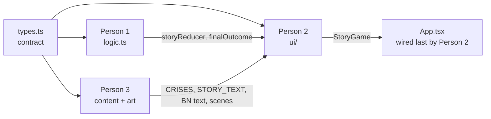

# Team plan: building "14 Sols" with 3 people

The game is described in [docs/design/04-story-plan.md](../design/04-story-plan.md). This page splits the work between **3 people who work independently** and merge at the end without conflicts.

## The rule that prevents conflicts

**Each file has exactly one owner. You only create or edit files you own.** If you need something in someone else's file, ask them in the team chat.

| Person | Role | Branch | Owns (only these) | Task doc |
|---|---|---|---|---|
| **Person 1** | Logic | `story/logic` | `src/story/logic.ts`, `tests/story.test.ts` | [person-1-logic.md](person-1-logic.md) |
| **Person 2** | Screens | `story/screens` | `src/story/ui/` (all files), `src/story/ui/story.css`; **at the very end only:** `src/App.tsx`, `src/screens/Title.tsx`, `src/engine/types.ts`, `src/engine/flow.ts` | [person-2-screens.md](person-2-screens.md) |
| **Person 3** | Content and science | `story/content` | `src/story/content/` (all files), `src/story/art/` (all files), `docs/NASA-DATA.md` | [person-3-content.md](person-3-content.md) |

**Shared and frozen:** `src/story/types.ts` (the contract). Nobody edits it on their own branch. If it must change, agree in the chat; Person 1 changes it on `main` and everyone pulls.

## Step 0 (team lead, once): merge `plan` into `main`

The `plan` branch adds only docs and two new files the game doesn't use yet, so merging it doesn't change the live game. After that, everyone branches from `main`.

## What exists on `main` after step 0 (your starting point)

- `src/story/types.ts`: the contract (all shapes and function signatures).
- `src/story/content/crises.ts`: the full English story as data (first draft).
- `docs/design/04-story-plan.md`: the plan, including the exact calculation.

So everyone can start at the same time: Person 2 builds screens using the real story data, Person 1 builds logic against the types, Person 3 polishes text, adds Bangla and draws the scenes.

## How the pieces connect



- Person 2's screens **import** from `../logic`, `../content/...` and `../art/...`. They never copy that code.
- Until Person 1's `logic.ts` is merged, Person 2 uses a temporary file `src/story/ui/mockLogic.ts` (their own) and deletes it before the final merge.

## Steps for everyone

1. `git checkout main && git pull`
2. `git checkout -b <your branch>` (see table)
3. Work only in your files. Commit often.
4. Before pushing, all three must pass:
   ```bash
   npm run typecheck
   ```
   ```bash
   npm test
   ```
   ```bash
   npm run build
   ```
5. Push your branch and open a pull request into `main`. **Don't merge yet.**

## Merge order (at the end)

1. **Person 1 (`story/logic`)** merges first. It only adds new files.
2. **Person 3 (`story/content`)** merges second. It only touches its own folders and `docs/NASA-DATA.md`.
3. **Person 2 (`story/screens`)** pulls `main`, deletes `mockLogic.ts`, switches imports to the real `logic.ts`, does the final wiring (App, Title button), checks the whole game, then merges last.

Because nobody shares a file, steps 1 and 2 cannot conflict. Step 3 is the only one that touches existing game files, and only Person 2 touches them.

**Merging to `main` puts the game live.** The team lead gives the OK for step 3.

## Definition of done (whole team)

- [ ] Title → prologue → 4 crises × 2 decisions → ending, in English and Bangla
- [ ] No hint of good or bad before the ending
- [ ] The ending always matches `finalOutcome()` (tested over all 256 combinations)
- [ ] Fail screen shows the reason and the player's own decisions
- [ ] Works at 1280×760, 1024×768 and 812×375, offline, no console errors
- [ ] Every NASA fact in the story has a source link in `docs/NASA-DATA.md`

## Talking to each other

- Post in the team chat when you push something others depend on (types change, logic merged, new art names).
- Name the file and line when you ask for a change in someone else's file.
- If you're blocked for more than an hour, say so.
