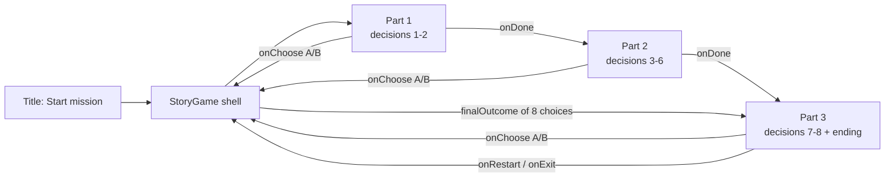

# Team plan: building "14 Sols" with 3 people

**Read first:** [docs/design/04-story-plan.md](../design/04-story-plan.md), the master story. It has the full story text, every decision, the hidden calculation, the real NASA data and the art list. Everyone builds from that one file, so we stay on the same page.

## How the work is split

The game is cut into **3 parts of the story**. Each person owns **one whole part**: its screens and logic, its pictures and its text (English and Bangla).

| Person | Part | Story | Decisions | Pictures | Branch | Task doc |
|---|---|---|---|---|---|---|
| **Person 1** | Part 1: The fall | Prologue on the ship, crisis 1, the landing | 1, 2 | `ship`, `orbit`, `descent` | `story/part1` | [part-1.md](part-1.md) |
| **Person 2** | Part 2: Surviving Mars | Crisis 2 (dust storm), crisis 3 (solar storm) | 3, 4, 5, 6 | `dustStorm`, `solarStorm` | `story/part2` | [part-2.md](part-2.md) |
| **Person 3** | Part 3: The way home | Crisis 4 (launch day), both endings | 7, 8 | `launch`, `home`, `stranded` | `story/part3` | [part-3.md](part-3.md) |

## The rule that prevents conflicts

**You only edit files inside your own folder.**

| Folder or file | Owner |
|---|---|
| `src/story/part1/` | Person 1 |
| `src/story/part2/` | Person 2 |
| `src/story/part3/` | Person 3 |
| `tests/story-part1.test.ts`, `-part2`, `-part3` (optional, new) | The matching person |
| **Frozen, nobody edits:** `src/story/types.ts`, `src/story/core/*`, `src/story/StoryGame.tsx`, `tests/story.test.ts`, `docs/design/04-story-plan.md`, and the wiring in `src/App.tsx`, `src/engine/*`, `src/screens/Title.tsx` | Team lead, only with everyone's OK |

If you think a frozen file must change, post it in the team chat first. Never change it on your own branch.

## What is already built (on the `plan` branch)

The whole game **already runs end to end** with simple placeholder pictures. You are upgrading your part, not starting from nothing.

- `src/story/types.ts`: the contract. Your part gets `PartProps` (Person 3 gets `FinalPartProps`).
- `src/story/core/outcome.ts`: **the hidden calculation, done and tested** (`tests/story.test.ts` checks all 256 paths). Nobody re-codes it.
- `src/story/core/labels.ts`: short labels for all 16 options (used by the ending).
- `src/story/core/Beats.tsx`: a simple shared player for story lines, decisions and facts. You may use it, or build your own screens in your folder.
- `src/story/core/story.css`: the shared layout (`story-` classes).
- `src/story/StoryGame.tsx`: runs part 1 → part 2 → part 3 and passes the choices along.
- Each part folder has a working starter: `index.tsx` (the component), `content.ts` (English + first-draft Bangla, exactly as in the master story), `art.tsx` (placeholder pictures) and `partN.css`.
- **Start mission** on the title screen opens the story.

## How the parts connect (the contract)



Every part must:
1. Call `onChoose("A" | "B")` **exactly once per decision, in order** (Part 1: 2 times, Part 2: 4 times, Part 3: 2 times).
2. Call `onDone()` when it's finished (Part 3 shows the ending instead, using `outcome`).
3. Use `lang` ("en" or "bn"), `readAloud`, `reduceMotion` and `playerName` from the props.
4. Never show whether a choice was good or bad.

## Steps for everyone

1. `git fetch && git checkout plan && git pull`
2. `git checkout -b story/partN` (your part number)
3. Work only in your folder. Commit often.
4. Before pushing, all three must pass:
   ```bash
   npm run typecheck
   ```
   ```bash
   npm test
   ```
   ```bash
   npm run build
   ```
5. Play the whole game (`npm run dev`, then **Start mission**) in English and Bangla, at 1280×760, 1024×768 and 812×375.
6. Push and open a pull request **into `plan`** (not `main`).

## Merging at the end

1. All three pull requests go into `plan`, in any order. They can't conflict, because each touches only its own folder.
2. The team lead plays the full game on `plan` once more.
3. The team lead merges `plan` into `main`. **That puts the game live.**

## Done when (whole team)

- [ ] Prologue → 4 crises → ending works, in English and Bangla
- [ ] Every line matches the master story
- [ ] No hint of good or bad before the ending
- [ ] Endings match `finalOutcome()`: try `AAAAAAAA` (Fail: fuel), `BBBBBBBB` (Fail: health), `AABAAAAA` (Success)
- [ ] All 8 pictures drawn (no words inside pictures)
- [ ] Works at the three sizes, offline, no console errors
- [ ] Every NASA fact links to its source
